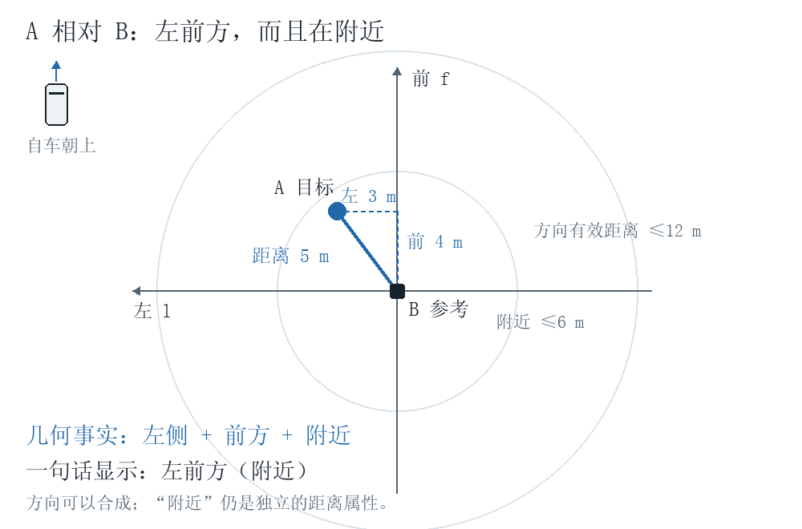

# 同一对物体的关系怎么理解

固定例子中，A在B左侧3米、前方4米，直线距离5米。因此“左侧”“前方”“附近”可以同时成立；给人看的说法可合成“左前方（附近）”。“附近”是距离属性，不能和前后左右强制排他。

同一对物体可以只保存一条边，再在边上保存多个几何属性；交换A、B可按规则查询逆关系。方向依据当前共同坐标框架，并不等于物体自身车头方向。

本图解释当前冻结的near≤6米、方向范围≤12米、分量门限>1米。它不修改关系算法，也不证明停车区、车位或车辆路径可行。

文件包括PNG预览、SVG图形和`relation-frame-explainer.html`对话内交互源。HTML片段由应用加载；GitHub上优先看上方PNG。交互源支持拖动A、改变自车朝向、交换A/B和切换多标签／复合方位。

验证范围：静态PNG已目检；数值、交换、朝向、拖动及状态恢复共6项Node执行检查通过。未安装浏览器，未声称浏览器布局经过实测。
