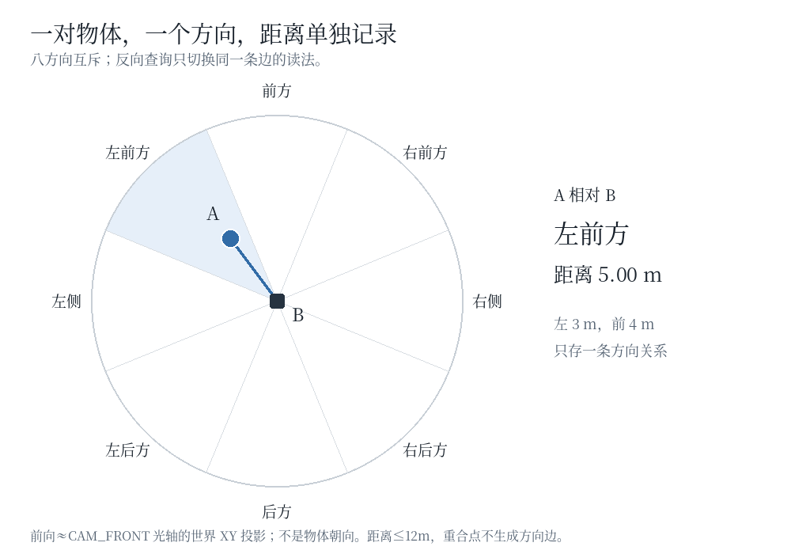

# 八方向单关系与距离属性

用户已确认的定义：一对有效物体至多存一条方向边，方向从前、左前、左、左后、后、右后、右、右前八类中选一个；XY距离以米单独记录，没有near关系边。A位于B左3米、前4米时，唯一方向是**左前方**，距离**5米**。反向查询读作B在A右后方，不再存第二条反向边。

方向按前向为0度、朝左为正的45度半开扇区判定，前方区间为[-22.5°,22.5°)。沿用12米邻接范围，XY中心距离≤1e-6米时不生成方向边。新合同取消旧1米分量死区和旧多谓词置信度/TopK剪枝；动态和unknown只要XY有效均可参与，节点保持原样。实际实现及独立GT评价正在新版本中核验，旧8场景资源试验不能直接冒充新关系结果。

关系描述source相对target，delta=source-target；存储端点按稳定ID字典序规范化，查询时按需反转八方向。示意图的A/B ID顺序对应存储A相对B。实际前向仍是CAM_FRONT光学+Z在world XY平面的归一化投影，左向为`[-f_y, f_x]`，只是自车朝向的工程近似，不代表物体自身车头。

新文件为`relation-eight-distance.{png,svg,html}`。交互只展示一个方向与距离，支持拖动A、旋转参考轴、正反向查询。PNG已目检；实际HTML脚本的默认3/4/5、单边、逆查询、旋转、八方向、22.5°半开边界、重合、12米、拖动与恢复共10项Node检查通过。没有声称浏览器布局经过实测。

## 历史多关系图（保留，非后续默认）

固定例子中，A在B左侧3米、前方4米，直线距离5米。旧版分别产生“左侧”“前方”“附近”几何事实；给人看的说法可合成“左前方（附近）”。此处只说明旧实现，不作为用户确认后的新关系定义。

展示时可把同一对物体合成一条线，并在其上显示多个几何属性；实际当前代码仍为每个几何事实保存canonical边，并按规则查询逆关系，图没有修改存储结构。

实际代码的共同前向是 **CAM_FRONT相机光轴+Z在world XY平面的投影并归一化**，作为自车朝向近似；左向为`[-f_y, f_x]`。图中“参考轴转角”只旋转此示意共同参考系，0°表示图上朝上，未声称真实车辆yaw为0，更不代表A/B物体自己的车头方向。来源为`nuscenes_full_20261125_run.py`的`camera_pose[:2,2]`及`relation_nav_unified_20261125.py`的`frame_metadata`。

本图解释当前冻结的near≤6米、方向范围≤12米、分量门限>1米。它不修改关系算法，也不证明停车区、车位或车辆路径可行。

文件包括PNG预览、SVG图形和`relation-frame-explainer.html`对话内交互源。HTML片段由应用加载；GitHub上优先看上方PNG。交互源支持拖动A、改变自车朝向、交换A/B和切换多标签／复合方位。

验证范围：静态PNG已目检；数值、交换、朝向、拖动及状态恢复共6项Node执行检查通过。未安装浏览器，未声称浏览器布局经过实测。
