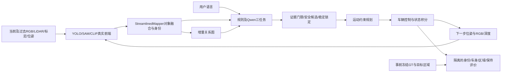

# 项目框架与实际调用链

项目主任务是在车载RGB、LiDAR投影稀疏深度、已知位姿及地图先验下维护对象与关系，理解语言静止目标，选择合法接近区域并用真实控制状态验证到达。它不是独立SLAM、通用自动驾驶栈或全交通规则自动泊车系统。

图中最后的评价支路不回流到方法。可视化读取已保存证据，不计新增实验。

## 三条链不能混写

| 链 | 实际入口/关键实现 | 可报告的结果 |
|---|---|---|
| 录制数据与离线开发 | development_causal_inputs → development_causal_mapping；OnlineSemanticNavigator及录制检索/规划评价 | 对象、关系、检索、录制回放或规划诊断；不能凭路线报告实际到达 |
| 固定逻辑时钟交互/复现 | live_navigation_worker.run → InteractiveRoadEnvironment + PerceptionVehicleAgent | 动作改变下一次传感器，保存真实前端及实际控制；不能据固定逻辑时钟声称硬实时 |
| 真实墙钟主对比/故障 | realtime_matrix / realtime_faults → realtime_navigation.run_task → WallClockVehicle + NavigationSemanticBridge + RealtimeSemanticQueue | 实际排队/迟到/过期与控制轨迹；按独立评价记录四类结果 |

## 数据对象

`gobs`保存真实检测/掩膜/视觉证据；`MappingFrame`带深度、标定、位姿和时间；对象的`stable_object_id`是系统轨迹身份；关系边需明确参考系与时效；`VehicleState`描述后轴状态；`GoalTruth`属于隔离评价端。

实时主链的语义桥接先验证候选安全，再允许重排参与选择。当前障碍与路径失效信息先传给控制侧，感知包过期则制动。锁定身份不意味着仍能安全复用旧路径。不得简化成“Qwen直接输出车辆控制”。

每个入口对应的实际函数、行号及模块依赖见代码索引。参数要从实际运行release读取；代码默认值不自动等于所有历史实验参数。
